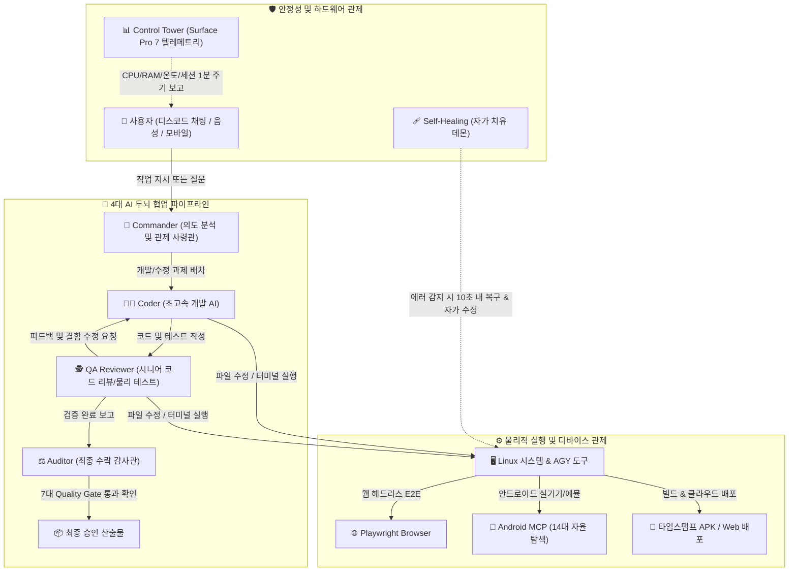

# 🤖 AGY 3.0 Agent & Control Tower
> **Google Antigravity 기반의 자율 멀티 에이전트 소프트웨어 생산 공장 & 디스코드 원격 바이브 코딩 관제탑**
> 
> GitHub 저장소: https://github.com/wkdtjd0303-bit/agy_agent

---

## 💡 AGY Agent는 어떤 시스템인가요? (한눈에 보기)

**"스마트폰이나 PC 디스코드에서 말 한마디만 하면, AI 개발팀이 코딩부터 테스트, 실기기 검증, 배포까지 100% 자율 완결합니다."**

기존의 챗봇은 단순히 말(텍스트)만 알려줄 뿐 실제로 파일을 고치거나 프로그램을 실행하지 못했습니다.  
**AGY Agent**는 단순한 대화형 AI가 아니라, **실제 컴퓨터 시스템과 디바이스를 직접 제어하는 자율 소프트웨어 엔지니어링 팩토리**입니다.



---

## 🌟 핵심 기능 8선 (쉬운 설명 & 상세 기능)

### 1. 👥 4대 AI 두뇌 협업 시스템 (The Trio + Commander)
혼자서 코딩하면 누구나 실수나 착각(환각)을 할 수 있습니다. AGY Agent는 실제 개발 회사의 분업 체계처럼 **4개의 전문 AI가 한 팀**이 되어 서로를 교차 검증합니다:

* 👑 **Commander (의도 분석 사령관 - Gemini 3.7 / 3.8 Flash)**:
  * 사용자가 보낸 메시지가 단순 질문인지, 기획 자문인지, 실제 코드 개발인지를 0.5초 만에 사전 분석합니다.
  * 복잡도에 따라 가벼운 작업은 단일 에이전트(`Single`)로, 고난도 개발은 3중 협업부대(`Pair`)로 최적 배차합니다.
* 👨‍💻 **Coder (초고속 개발자 - Gemini 3.8 Flash / 3.7 Flash High)**:
  * 번개처럼 빠른 속도로 수백 줄의 코드를 작성하고, 여러 파일을 한 번에 수정합니다 (`write_to_file`, `replace_file_content`).
  * 가짜 코드(목업, 단순 주석) 없이 실제로 동작하는 비즈니스 로직과 UI 컴포넌트를 직접 구현합니다.
* 🕵️ **QA Reviewer (시니어 코드 검증관 - GPT-OSS 120B / Gemini 3.1 Pro High)**:
  * Coder가 짠 코드를 시니어 개발자의 시선으로 깐깐하게 리뷰합니다.
  * 문법 오류뿐만 아니라 보안 취약점, 플랫폼 헌법 준수 여부, 실제 E2E 테스트 통과 여부를 물리적으로 채점합니다.
* ⚖️ **Auditor (최종 수락 감사관 - Gemini 3.1 Pro High)**:
  * 사용자 요구사항(PRD)과 7대 품질 게이트를 전수 대조하여, 물리적 증거(Evidence JSON/스크린샷)가 디스크에 완비되었을 때만 최종 합격(PASS) 판정을 내립니다.

---

### 2. 🏛️ 7대 Quality Gate & 물리적 증거(Evidence) 원칙
> **"PASS = AI의 주관적 주장이 아니라, 자동 검증 가능한 물리적 Evidence 파일이 존재하고 검증기를 통과해야 한다."**

AGY Agent는 "코드 다 짰습니다"라는 AI의 말만 믿지 않습니다. 각 단계마다 디스크에 물리적 검증 파일이 기록되어야 다음 단계로 넘어갑니다:

| 게이트 | 명칭 | 검증 내용 및 물리적 증거 (Evidence) |
|---|---|---|
| **Gate 0** | 프로젝트 상태 분석 | 프로젝트 구조 파악, 기존 테스트 무결성 확인 (`reports/gate0/project_state.json`) |
| **Gate 1** | 기획 & 요구사항 | 확정 기획서(`PRD.md`) 및 사용자 흐름도(`USER_FLOW.md`) 정합성 |
| **Gate 2** | 설계 & UX 표준 | 아키텍처 다이어그램, 반응형 토큰, 48dp 모바일 터치 타겟 준수 |
| **Gate 3** | 무결점 조립 구현 | Core ➔ Data ➔ UI ➔ OS Integration 단계적 조립 완료 |
| **Gate 4** | 기능 E2E 물리 검증 | Pytest, Vitest, Playwright, Android MCP 실제 실행 결과 (`reports/gate4/e2e_test.json`) |
| **Gate 5** | 시각적 Visual QA | 실제 디스플레이 프레임버퍼 캡처 스크린샷 6종 이상 및 레이아웃 검증 (`reports/gate5/visual_qa.json`) |
| **Gate 6** | 실기기 & 회귀 방지 | 기존 기능 손상 여부 자동 재검증 (**Regression Lock**) |
| **Gate 7** | 릴리즈 승인 | 바이너리 SHA256 해시 검증, Critical 결함 0건, Major 결함 0건 보장 |

---

### 3. 📱 Android MCP 실기기/에뮬레이터 자율 탐색 (REQ-005)
안드로이드 앱을 만들었을 때, 사람이 일일이 에뮬레이터를 켜서 눌러보지 않아도 에이전트가 직접 앱을 사용해보며 버그를 찾습니다:

* **14대 자율 탐색 파이프라인**:
  * ADB 및 Model Context Protocol (MCP) 도구를 이용해 앱 실행, 화면 계층 트리(UI Hierarchy Dump) 분석, 좌표 터치, 제스처 스와이프, 키보드 타이핑을 자율 수행합니다.
* **스마트 브랜치 계층 탐색 & 백트래킹 (Backtrack)**:
  * 탭, 서브메뉴, 설정창 등 하위 페이지를 깊숙이 탐색하고, 작업이 끝나면 뒤로가기(`keyevent 4`)를 통해 원래 화면으로 안전하게 복귀합니다.
  * 방문한 화면 스택을 관리하여 무한 루프(뒤로가기 반복)에 빠지지 않습니다.
* **시각 프레임버퍼 감사**:
  * 화면이 깨지거나 버튼이 겹치면 실제 캡처된 스크린샷을 분석하여 즉시 Coder에게 수정을 요청합니다.

---

### 4. 🔨 자동 타임스탬프 APK 빌드 & 구글 드라이브 클라우드 배포
안드로이드 프로젝트 작업 시 채팅창에서 명령어 하나만 입력하면 최신 앱 파일이 생성됩니다:

* **무인 타임스탬프 빌드**:
  * Gradle 빌드를 자동 수행하여 빌드 일시가 기록된 파일(`{AppName}-YYYYMMDD_HHMMSS.apk`)과 최신 복사본(`{AppName}-latest.apk`)을 함께 생성합니다.
* **원클릭 구글 드라이브 업로드**:
  * 빌드가 끝나면 즉시 Google Drive 클라우드로 자동 업로드하고, 디스코드 채팅방에 스마트폰에서 바로 다운로드할 수 있는 링크를 게시합니다.

---

### 5. 🔄 무인 자율 연속 진화 (`!auto on`, `!auto on evolve`)
개발자가 잠든 밤 사이에도 시스템이 스스로 서비스를 발전시킵니다:

* **무인 품질 검증 (`!auto on`)**:
  * 배포된 웹 URL(`https://...web.app`)이 감지되면, 사용자의 입력이 없어도 Playwright 헤드리스 브라우저로 실제 접속하여 UI 깨짐과 콘솔 에러를 점검하고 버그가 0건이 될 때까지 스스로 고칩니다.
* **무인 연속 진화 (`!auto on evolve`)**:
  * 버그가 전혀 없는 상태가 되면, 로드맵(`ROADMAP.md`)의 다음 목표 기능을 스스로 찾아 새 기능을 개발하고 E2E 테스트를 거쳐 자동 배포하는 무한 성장 사이클을 가동합니다 (롤백 보호 내장).

---

### 6. 🩹 스마트 자가 치유 (Self-Healing & Watchdog)
시스템에 예기치 않은 오류가 발생해도 관리자가 서버에 접속할 필요가 없습니다:

* **10초 내 자동 재기동**: 데몬 프로세스가 비정상 종료되면 systemd Watchdog이 10초 내(`RestartSec=10`)에 자동으로 다시 살려냅니다.
* **에러 정황 자동 분석 & 자가 수정(Self-Coding)**:
  * 예외가 발생하면 관리자 채널(`!5_agy_agent`)에 에러 로그를 보고하고, AGY 에이전트가 호출되어 버그가 발생한 파이썬 소스코드를 직접 분석·수정한 뒤 무중단 핫리로드합니다.
  * 무한 루프 방지 지능형 쿨다운이 내장되어 있습니다.

---

### 7. 📊 Surface Pro 7 실시간 텔레메트리 관제탑 (Control Tower)
로컬 하드웨어 장비와 전체 디스코드 채널의 AI 세션을 24시간 실시간으로 감시합니다:

* **하드웨어 텔레메트리 (1분 주기 실시간 갱신)**:
  * CPU 사용률, RAM 점유량, NVMe SSD 잔여 용량, 배터리 충전 상태.
  * **Thermal Guard**: Surface Pro 7의 발열 온도를 실시간 감시하여 스로틀링과 과열을 사전 예방.
* **채널별 AI 세션 관제**:
  * 현재 실행 중인 에이전트 모델 이름, 토큰 소모량, 대기열 상태(초록불 `waitgreen`)를 디스코드 임베드 대시보드에 실시간 중계합니다.

---

### 8. 📸 스크린샷 실측 기획 결손 폐루프 (Planner Visual Gap)
> **"E2E 스크린샷은 CODER·QA만의 검증 재료가 아니다. COMMANDER가 다음에 무엇을 기획할지 판단하는 1차 물리 증거다."**

소스코드/PRD만 보고 기획하면 "전체 E2E 시나리오 테스트 100% 무결점 통과" 같은, 겉보기엔 그럴듯하지만
사용자가 화면에서 체감하는 부족함은 하나도 못 고치는 자기참조적 과제가 나옵니다.

* **실 렌더링 화면 비전 진단**: `reports/gate5/screenshots/*.png` 를 CPO(제품 책임자) 관점 멀티모달 Vision으로 분석하여
  "화면에 아직 없는 핵심 기능/패널/UX 단계"를 `[CORE_FEATURE / UX_WORKFLOW / LAYOUT_PANEL / ACCESSIBILITY / PERFORMANCE / POLISH]` 로 구조화합니다.
* **기획 프롬프트 물리 증거 주입 + 일반론 차단**: 차기 마일스톤 기획 시 가장 가치 높은 결손 1건을 원자적으로 해소하도록 강제하고,
  화면 결손이 남아 있는데 "전체 E2E 통과/품질 하드닝" 류 일반론으로 도망가면 강제 교체합니다.
* **자문/로드맵까지 확장**: `!read`("무엇이 부족해?") 자문과 `ROADMAP.md` 자동 확장에도 스크린샷 결손을 1순위 후보로 승격합니다.
* 물리 증거: `reports/planner/visual_gap_review.json` · 상세 설계: [`docs/PLANNER_VISUAL_GAP.md`](docs/PLANNER_VISUAL_GAP.md)

---

### 9. 📦 제품 가치 기획 — 하드닝 단독 마일스톤 원천 차단 (Product Value Planning)
> **"품질 하드닝은 기획이 아니다. 기획자는 '사용자가 화면·동작에서 아직 체감하지 못한 신규 기능'을 다음 마일스톤으로 발주한다."**

스크린샷 결손(Visual Gap)은 '이미 렌더링된 화면'이 있어야 동작합니다. 초기/헤드리스/CLI/백엔드
프로젝트에서는 증거가 없어 Commander가 곧바로
`경계 조건 및 대용량 데이터 입력 시 크래시 방어` · `응답 속도 최적화 및 불필요한 연산 제거` ·
`전체 E2E 시나리오 테스트 100% 무결점 통과` 같은 **자기참조적 품질 하드닝**으로 수렴했습니다.

* **도메인별 사용자 가치 카탈로그**: `product_value_planner.py` 가 도메인별(웹/모바일/게임/CLI/백엔드)
  "아직 없는 사용자 체감 기능"(내보내기·공유, 검색·필터, 설정·개인화, 즐겨찾기, 업적/리더보드,
  일시정지·옵션, 플러그인, 페이지네이션, 웹훅, API 문서 등)을 물리 디스크 증거와 대조해
  가장 가치 높은 1건을 다음 마일스톤 후보로 선택합니다.
* **하드닝 전용 판정 가드**: `is_hardening_only_plan()` 이 제목/과제가 순수 방어·검증으로만 구성된
  기획을 판정하고, 사용자 가치 기능이 남아 있으면 **강제 교체**합니다.
  (사용자 피드백 · 코드 신호 결손 · 심도 심화 · 스크린샷 결손 플랜은 절대 덮어쓰지 않습니다.)
* **폴백 위치 교정**: Commander 결정론적 폴백(게임 종단/모바일 캐시/웹 SaaS 종단),
  AI 5W1H 기획, `ROADMAP.md` 자동 확장 모두 하드닝 템플릿보다 가치 기능을 먼저 발주합니다.
* **표시**: 기획서/임베드/Coder 훈령에 `📦 제품 가치 기획` 블록이 동봉됩니다 (source 배지: 📦 `product_value`).
* 설정: `COMMANDER_PRODUCT_VALUE_ENABLED=1` (기본 ON) · 상세 설계: [`docs/PRODUCT_VALUE_PLANNING.md`](docs/PRODUCT_VALUE_PLANNING.md)

---

## 🛡️ 가시적 실체 구현 & 안티 모킹(Anti-Mocking) 헌법

AGY Agent의 코드베이스에는 엄격한 개발 헌법(`PROJECT_CONSTITUTION.md`)과 물리적 검증기(`evidence_validator.py`)가 상시 작동합니다:

1. **사용자 질문 직접 답변 최우선 원칙 (User Question Direct Answer First)**:
   * 사용자가 질문("몇 점이야?", "원인이 뭐야?", "해결책이 뭐야?", "어떻게 생각해?")을 던졌을 때, 불필요한 협업 보고서를 앞세우지 않고 **질문에 대한 핵심 답변을 최상단에 명쾌하게 제시**합니다.
2. **비가시적 눈속임 금지**:
   * 단순 주석 추가, 변수 이름 변경, 가짜 테스트 파일만 추가하고 끝내는 행위를 전면 금지하며, 실사용자가 체감할 수 있는 UI 컴포넌트와 비즈니스 로직을 반드시 구현합니다.
3. **레퍼런스 이미지 표절 및 트레이싱 원천 금지 (Rule 6c, 6d)**:
   * 사용자가 제공한 참고 이미지를 파이썬 코드(`Image.open`, `cv2.imread`)나 Base64로 직접 불러와 외곽선을 따거나 마스킹하여 결과물로 위장하는 행위를 엄격히 차단합니다.
   * 모든 에셋은 순수 절차적 코드(Procedural Code), 3D 리깅/모델링으로 직접 생성합니다.

---

## 💬 디스코드 명령어 가이드

디스코드 채팅창에서 누구나 손쉽게 입력할 수 있는 직관적인 명령어 목록입니다:

### 🚀 바이브 코딩 & 에이전트 모드
| 명령어 | 설명 | 예시 |
|---|---|---|
| `@봇이름 <내용>` | 멘션하여 원하는 기능 개발 또는 질문 | `@AGY 로그인 페이지 반응형으로 만들어줘` |
| `!pair <요청>` | Coder ↔ QA ↔ Auditor 3중 협업 부대 풀코스 개발 가동 | `!pair 결제 모듈 예외 처리 추가해줘` |
| `!read <질문>` | **🔍 3중 읽기/기획 전용 자문** (코드 수정 없이 아키텍처 및 로드맵 도출) | `!read 현재 데이터베이스 구조 문제점 분석해줘` |
| `!mode [auto\|pair\|read\|single]` | 채널 기본 동작 모드 변경 (자동 / 3중 협업 / 읽기 전용 / 단일) | `!mode auto` |
| `!role [qa\|coder]` | 채널 역할 즉시 전환 (`!role qa`: 시니어 QA 검증관 모드) | `!role qa` |

### 🎛️ AI 엔진 & 오토파일럿
| 명령어 | 설명 |
|---|---|
| `!engine` | 🎛️ 멀티 AI 코딩 엔진 선택 UI (Antigravity, Claude, Codex, Aider 1클릭 전환) |
| `!auto on` | 🎯 무인 품질 검증 & 결함 핫픽스 자동 순환 시작 |
| `!auto on evolve` | 👑 무인 자율 연속 진화 (결함 0건 달성 후 다음 로드맵 기능 자동 개발) |
| `!auto off` / `!auto run` | 오토파일럿 중단 / 대기 없이 즉시 1회 검증 실행 |
| `!commander` | 👑 Commander 의도 분석 엔진 상태 확인 및 모의 테스트 |

### 📱 모바일 & 안드로이드 MCP
| 명령어 | 설명 |
|---|---|
| `!sim` | 📱 60fps 실시간 모바일 인터랙티브 스튜디오 (웹/디스코드 뷰어) |
| `!apk` | 🔨 최신 안드로이드 APK 실시간 빌드 & 구글 드라이브 다운로드 링크 발행 |
| `!android` / `!apk_test` | 📱 Android MCP 실기기 E2E 14대 자율 탐색 검증 실행 |

### 📂 세션 & 시스템 관리
| 명령어 | 설명 |
|---|---|
| `!pwd` | 현재 채널의 작업 디렉토리(CWD), 활성 모델, 토큰 사용량 확인 |
| `!cd <경로>` | 현재 채널의 작업 디렉토리 변경 (영구 저장되어 재부팅 후에도 유지) |
| `!new` | 현재 채널/스레드의 대화 세션 ID 초기화 (새 프로젝트 시작 시) |
| `!reset` | 🔄 0초 다운타임 무중단 인메모리 핫리셋 & 모듈 핫리로드 |
| `!reset all` | 🧹 무중단 핫리셋 + 전체 채널 세션 ID 및 대기열 완전 초기화 |
| `!export` / `!대화백업` | 📜 채널 대화 기록을 Markdown(.md) 파일로 즉시 다운로드 |
| `!zip` | 📦 현재 채널 작업 디렉토리 전체 압축 다운로드 |
| `!status` / `!uptime` | 🖥️ 시스템 Uptime, PID, Surface Pro 7 하드웨어 리소스 확인 |
| `!help` | 🤖 카테고리별 원터치 버튼 & 드롭다운 대화형 종합 안내판 열기 |

---

## 🏗️ 시스템 아키텍처 및 폴더 구조

```text
agy_agent/
├── bot.py                        # 🚀 디스코드 봇 메인 게이트웨이 & 이벤트 라우터
├── commander.py                  # 👑 Commander (의도 분석 및 지능형 배차 사령관)
├── planner_visual_gap_analyzer.py # 📸 Commander 기획용 스크린샷 실측 제품 결손 분석기
├── product_refinement_governor.py # 🧭 심도 우선(Depth-First) 제품 완성도 거버너
├── trio_agent_runner.py          # 👥 3-Agent 파이프라인 (Coder ↔ QA ↔ Auditor)
├── mode_classifier.py            # 🧠 딥러닝/LLM 기반 질문/개발 모드 자동 분류기
├── evidence_validator.py         # 🏛️ Gate 0~7 물리적 검증기 & 안티 모킹/트레이싱 감사
├── auto_pilot.py                 # 🔄 자율 E2E 피드백 & 연속 진화 엔진
├── android_emulator_manager.py   # 📱 안드로이드 에뮬레이터 생명주기 관리자
├── android_mcp_server.py         # 🔌 Android Model Context Protocol (MCP) 서버
├── android_mcp_tools.py          # 🛠️ Android MCP 12대 제어 도구 (터치/입력/덤프/키)
├── android_mcp_planner.py        # 🗺️ 14대 자율 탐색 및 백트래킹 스택 플래너
├── android_build_manager.py      # 🔨 Gradle 빌드 & 타임스탬프 APK 자동 생성기
├── gdrive_uploader.py            # ☁️ Google Drive 클라우드 자동 업로더
├── mobile_simulator_server.py    # 📱 60fps 인터랙티브 모바일 시뮬레이터 서버
├── engine_manager.py             # 🎛️ 멀티 AI 엔진 관리자 (AGY, Claude, Codex, Aider)
├── model_registry.py             # 🧩 AI 모델 레지스트리 및 실시간 상태 어노테이션
├── telemetry_status_manager.py   # 📊 Surface Pro 7 하드웨어 & 세션 실시간 관제탑
├── thermal_guard.py              # 🌡️ 하드웨어 발열 감시 및 과열 방지 가드
├── self_healing.py               # 🩹 데몬 와치독 & 자가 코드 수정 복구 엔진
├── session_manager.py            # 💾 채널별 독립 작업 공간 영구 저장소
├── help_manager.py               # 📖 인터랙티브 디스코드 도움말 UI
├── PRD.md                        # 📋 제품 기획서
├── ARCHITECTURE.md               # 📐 상세 시스템 아키텍처 명세
├── PROJECT_CONSTITUTION.md       # ⚖️ 플랫폼 개발 헌법
├── service.sh                    # ⚙️ systemd 백그라운드 서비스 관리 스크립트
└── tests/                        # 🧪 단위/통합/E2E 테스트 스위트
```

---

## 🚀 빠른 시작 가이드 (Quick Start)

### 1. 사전 준비
* **Python 3.10+** (가상환경 권장)
* **Google Antigravity CLI (`agy`)** 설치 및 로그인
* **Android SDK & ADB** (안드로이드 기능 사용 시)
* **Discord Bot Token** ([Discord Developer Portal](https://discord.com/developers/applications))

### 2. 환경 설정 (`.env`)
저장소를 클론한 후 `.env` 파일을 생성합니다:

```bash
git clone https://github.com/wkdtjd0303-bit/agy_agent.git
cd agy_agent

# 가상환경 생성 및 의존성 설치
python3 -m venv .venv
source .venv/bin/activate
pip install -r requirements.txt

# 설정 파일 구성
cp .env.example .env
```

`.env` 내용 예시:
```env
DISCORD_BOT_TOKEN=your_discord_bot_token_here
DEFAULT_WORKSPACE=/home/jangsung/Desktop/autocoding
COMMAND_PREFIX=!
AGY_PATH=agy
```

### 3. 서비스 실행 및 백그라운드 상시 가동
터미널을 닫아도 백그라운드에서 24시간 안전하게 가동되도록 `service.sh`가 제공됩니다:

```bash
# 서비스 상태 확인
./service.sh status

# 실시간 로그 스트리밍
./service.sh logs

# 서비스 시작 / 재시작 / 중지
./service.sh start
./service.sh restart
./service.sh stop
```

---

## 📄 라이선스 & 기여 안내
* 본 프로젝트는 개인 창업가, Vibe Coder, 자율 소프트웨어 에이전트 운영팀을 위한 무인 소프트웨어 엔지니어링 플랫폼입니다.
* 모든 기여와 버그 제보는 GitHub Issues 및 Pull Requests를 통해 환영합니다.
