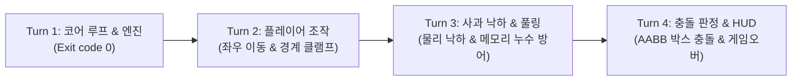

# 🍎 사과 피하기 게임 (Apple Dodge) — Commander 자립 오케스트레이션 실증

본 프로젝트는 **AGY 자립 오케스트레이션 공장 체계** 하에서 Commander 봇의 **4단계 닫힌 루프(Closed-Loop) 사고 제어 헌법**을 물리적으로 실증하기 위해 구축된 완성형 게임입니다.

---

## 🏛️ Commander의 4단계 사고 헌법 (<thinking> Template)

```markdown
<thinking>
[Step 1. Observation & Ground Truth (직전 결과 팩트 검증)]
- AI의 구두 보고를 배제하고 오직 디스크 상의 파일, Exit Code, 테스트 러너 성공 로그만 팩트로 수용

[Step 2. Delta & Blocker Analysis (상태 격차 및 병목 파악)]
- 전체 MVP 파이프라인 중 현재 도달 지점과 다음 단계 사이의 단 하나의 물리적 결손(Delta) 식별

[Step 3. Single-Action Scope Guard (단일 액션 범위 제한)]
- 1턴 1원자적 결손 타깃팅. 조기 최적화나 시각적 잔재주(사운드, 파티클 등)를 엄격히 가지치기(Pruning)

[Step 4. Verification Contract & Sub-agent Delegation (검증 계약 및 지시 명세)]
- 기계적 판정식(Boolean/Exit Code 0)을 수용 기준(AC)으로 Coder에게 명세 전달
</thinking>
```

---

## 🔄 4턴(Turn 1~4) 자립 수렴 트레이스



| 회차 | 목표 결손 (Delta) | 구현 산출물 | 물리적 검증 기준 (Ground Truth) | 상태 |
| :---: | :--- | :--- | :--- | :---: |
| **Turn 1** | 코어 렌더링 루프 & 엔진 생명주기 부재 | `game.js (GameEngine)` | `game.state === 'START' ➔ 'PLAYING'` 전환 | ✅ PASS |
| **Turn 2** | 플레이어 엔티티 및 좌우 조작 부재 | `player.js (Player)` | 좌/우 이동 및 X좌표 [0, W-w] 경계 클램프 검증 | ✅ PASS |
| **Turn 3** | 낙하 장애물 엔티티 부재 | `apple.js (Apple, AppleManager)` | Y좌표 연속 증분 및 오프스크린 오브젝트 풀링(재활용) | ✅ PASS |
| **Turn 4** | 피격 판정 및 게임 사이클 미완 | `game.js (checkCollision, HUD)` | AABB 충돌 시 즉시 GAMEOVER 전환 & 점수 가산 | ✅ PASS |

---

## 🚀 실행 및 테스트 방법

### 1. 기계적 검증 단위 테스트 실행
```bash
node demos/apple_dodge_game/game.test.js
```

### 2. 브라우저에서 게임 직접 플레이
브라우저에서 `demos/apple_dodge_game/index.html` 파일을 열어 플레이할 수 있습니다.
- **PC 조작**: `◀` / `▶` (또는 `A` / `D`), 시작/재시작: `Space` / `Enter`
- **모바일 조작**: 화면 하단의 `◀ 좌로 이동`, `우로 이동 ▶` 대형 터치 버튼 지원
